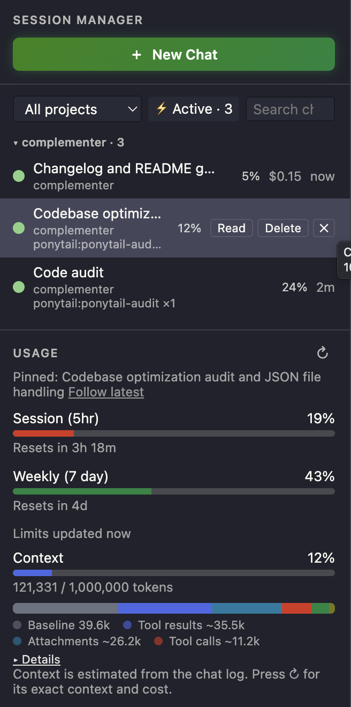
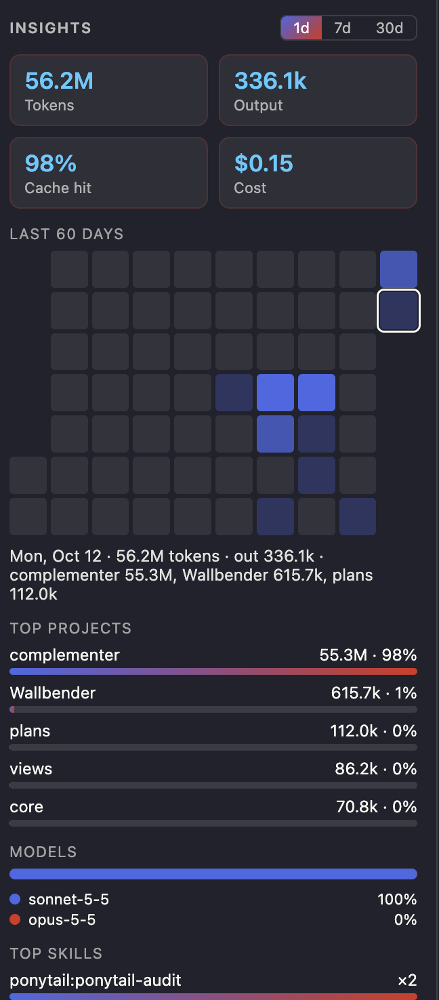

# Complementer

Shows what Claude Code does not: how full your context is, how much of your 5-hour and weekly limits you have used, and a place to manage your sessions.

Independent project, not affiliated with Anthropic.

Complementer is Claude Code on a booster, not a replacement: it needs the Claude Code extension and the `claude` CLI to work (see [Requirements](#requirements)).

  
  &nbsp;&nbsp;
  

## Features

- **Usage meters.** Context, 5-hour and weekly limits in the status bar and the Sessions panel, with reset countdowns. Yellow above 50%, red from 80%.
- **Session manager.** Chats grouped by project, each with its own context %. Search, open, read as a transcript, or delete (to the Trash, or permanently with ✕). Start a new chat in one click.
- **Insights.** Over 1, 7 or 30 days (1 by default): tokens, cache hit rate, cost, a 60-day heatmap, top projects, top skills, model mix and streak.
- **Context breakdown.** Under the Context meter (listed after the 5-hour and weekly meters): a full-width bar of what the used context is made of (fixed baseline, tool results, assistant text, your messages) with a colour-keyed legend and, under Details, the size per part and tool and the skills used in that session. The split is an estimate.
- **Account.** Your email, plan and organization.

## Getting started

1. Install [Complementer from the Marketplace](https://marketplace.visualstudio.com/items?itemName=pritompurkayasta.complementer), or run `ext install pritompurkayasta.complementer` in the Quick Open box (Ctrl/Cmd+P). It requires the Claude Code extension and the `claude` CLI (see Requirements).
2. Open the Complementer icon in the activity bar.
3. Run **Complementer: Enable live meters** to show the 5-hour and weekly limits.

Context % and the session list work without step 3.

## Live meters

Plan limits come from Claude Code itself, so most of this needs no setup.

- **Automatic.** Every few minutes the extension asks the Claude Code you already have installed for your 5-hour and weekly limits. No message is sent, so no plan usage. If that is not possible on your machine, press ↻ next to Usage.
- **Status line (optional).** Terminal sessions (`claude` in a terminal, or the `claudeCode.useTerminal` setting) also report limits and context through Claude Code's status line; the native chat panel does not run it. **Enable live meters** adds a small passthrough in front of yours: it asks first, shows the exact change, and keeps your own status line working. **Disable live meters**, or uninstalling, restores your settings exactly. With two copies installed, removing one leaves the other's alone.
- **↻ Refresh** (also **Complementer: Refresh limits**). Resumes the session shown under "Following" in a terminal, sends one short message ("hi"), waits for the limits, then exits and closes it. This also updates the context meter. It costs a few tokens and adds one short message to that chat, and asks first if the chat changed in the last minute (it may be open in the chat panel). If nothing arrives within 30 seconds (for example a trust prompt is waiting), the terminal stays open for you.
- **New chats.** When one appears, the extension offers the same refresh once for it (`complementer.autoActivateNewChats`: `ask` by default, or `off`).

## Commands

| Command | Action |
|---|---|
| Complementer: Enable live meters | Show the 5-hour and weekly limits (asks first) |
| Complementer: Refresh limits | Update the limits now (also the ↻ icon next to Usage). Resumes the followed session in a short `claude` terminal, sends "hi", then exits and closes it |
| Complementer: Disable live meters | Restore your original status line |
| Complementer: New Chat | Start a new chat |
| Complementer: Dock panel beside Claude chat | Move the panel next to the Claude chat |

## Privacy

Everything stays on your machine. There are no network calls and no telemetry. The extension reads your Claude Code session logs, the status-line data, and your email, plan and organization from `~/.claude.json`. It stores only daily token totals, skill counts and costs, never chat content.

## Requirements

VS Code 1.85 or newer, plus both of these, because Complementer only adds to them:

- the [Claude Code extension for VS Code](https://marketplace.visualstudio.com/items?itemName=anthropic.claude-code): its chats and logs are what Complementer reads, its bundled `claude` answers the plan-limit query, and it opens and starts your chats;
- the `claude` CLI on your PATH: the ↻ Refresh button and the new-chat prompt resume a chat with `claude --resume` in a terminal.

Node.js is not needed on macOS and Linux. On Windows, live meters need `node` on your PATH; enabling them stops with a message if it is missing. Tested on macOS only; Linux and Windows are untested.

## Contributing

Contributions are welcome. Open an issue first, and send a pull request once a maintainer confirms it. See [CONTRIBUTING.md](CONTRIBUTING.md). Release notes are in [CHANGELOG.md](CHANGELOG.md).

## License

[MIT](LICENSE). If the extension is useful to you, please star it on [GitHub](https://github.com/purkayasta/complementer).
